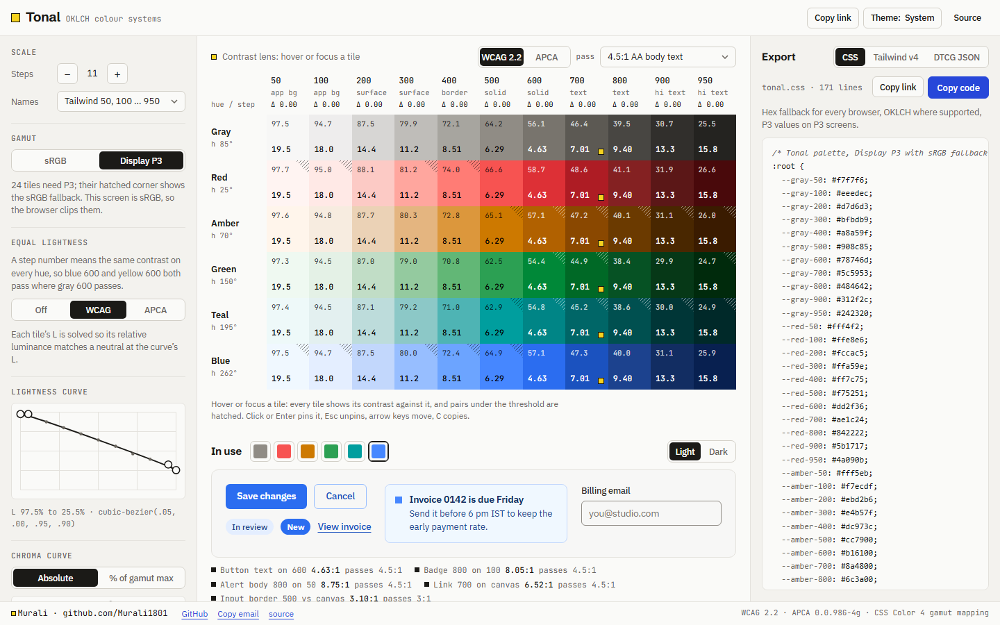
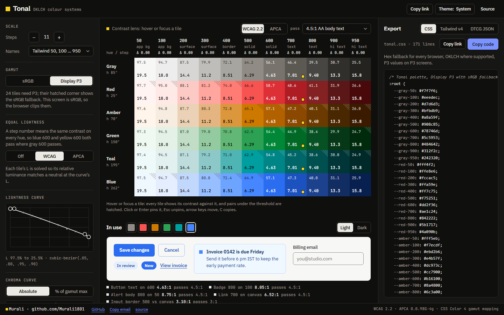

<p align="center">
  
  
</p>

# Tonal

Build accessible OKLCH colour scales and export them to CSS, Tailwind v4 and design tokens. Runs in your browser.

**Live demo:** https://tonal-murali.vercel.app

## Quick start

```bash
git clone https://github.com/Murali1801/tonal.git
cd tonal
npm install
npm run dev      # http://localhost:5173
npm test         # Vitest: colour math, APCA, WCAG, gamut mapping, solver, exports
npm run build    # static site in dist/
```

The npm package name is `tonal-color` (`tonal` is taken by the music theory library).

## Features

- **Equal lightness across hues.** Turn it on and Tonal solves each tile's OKLCH lightness so its relative luminance (WCAG) or APCA screen luminance matches a neutral grey at the same step. Blue 600 and amber 600 then have the same contrast. Each column header shows the spread (Δ) so you can see it hold.
- **Lightness and chroma curves.** Drag the bezier handles or use arrow keys. Chroma can be absolute or a share of the most the gamut allows at each lightness.
- **sRGB or Display P3.** Real gamut mapping with the CSS Color 4 algorithm. Tiles that only exist in P3 get a hatched corner that shows their sRGB fallback.
- **Contrast lens.** Hover or focus any tile and every other tile shows its contrast against it. Pairs under your threshold are hatched. Click or press Enter to pin it.
- **WCAG 2.2 and APCA.** Contrast ratio and APCA Lc (0.0.98G-4g, implemented in `src/core/contrast.ts` and tested against the reference values).
- **Contrast matrix.** Every text step on every background step, for any pair of hues.
- **Constraints.** "Step 700 at least 7:1 on white" moves only that step's lightness, as little as it can, and keeps the ramp in order.
- **Live preview.** Buttons, badges, an alert, a link and an input drawn with the palette in light and dark, with each pair's contrast printed under them.
- **Exports.** CSS custom properties (hex fallback, OKLCH in `@supports`, P3 values under `@media (color-gamut: p3)`), a Tailwind v4 `@theme` block, and DTCG JSON tokens.
- **Shareable.** The whole palette lives in the URL hash. No account, no backend.
- **Keyboard and phone friendly.** The grid is a roving-tabindex ARIA grid; controls fold into a drawer on small screens.

## How Tonal compares

Star counts read from the GitHub API on 2026-11-15.

| Tool | Stars | Best at | Where Tonal differs |
|---|---|---|---|
| [Leonardo](https://github.com/adobe/leonardo) | 2,167 | Contrast-first scales from target ratios | OKLCH-native output, Tailwind v4 and DTCG export, one screen |
| [oklch-picker](https://github.com/evilmartians/oklch-picker) | 2,019 | Understanding one OKLCH colour and its gamut | Whole multi-hue scales instead of a single colour |
| [Radix Colors](https://github.com/radix-ui/colors) | 1,736 | Hand-tuned 12-step scales with clear step roles | Your own hues and step count; standalone and open source |
| [tints.dev](https://github.com/SimeonGriggs/tints.dev) | 1,277 | Fast Tailwind palettes with a shareable URL | WCAG and APCA per step, contrast matrix, P3 |
| [Huetone](https://github.com/ardov/huetone) | 460 | Hue by step grid with APCA and editable charts | Guided layout, larger targets, Tailwind v4 and DTCG export |
| [Harmony](https://github.com/evilmartians/harmony) | 249 | Equal perceived lightness across hues | Editable curves, constraints, contrast lens and matrix, more exports |

Leonardo is the better choice if you think in target ratios for many backgrounds. oklch-picker is the best way to understand a single OKLCH colour. Tonal is for building a whole scale.

## How it works

- `src/core/` is pure TypeScript with no DOM: conversions and gamut mapping (`color.ts`), WCAG and APCA (`contrast.ts`), curves (`curves.ts`), step names (`steps.ts`), generation and the constraint solver (`palette.ts`), the URL format (`state.ts`) and exporters (`exports.ts`).
- Conversions and gamut mapping use [culori](https://culorijs.org) through its tree-shakeable `culori/fn` entry, with only the six colour modes Tonal needs registered. Its `toGamut` implements the CSS Color 4 mapping (binary search on OKLCH chroma with a deltaEOK limit of 0.02). It is smaller than colorjs.io in the bundle and has a functional API that fits a pure core.
- Equal lightness and constraints use bisection on L with chroma and hue fixed, re-mapping into the gamut at every step, so the result is always displayable.
- The UI is plain TypeScript and DOM, about 27 KB gzipped with culori. Nothing animates colour, so comparisons stay honest.

## Contributing

Issues and pull requests are welcome. Run `npm test` and `npm run build` before opening a PR. New maths in `src/core/` needs a test with a known value.

## Licence

[MIT](LICENSE) © 2026 Muralidhar Acharya

---

Part of a set of tools by Murali: Tonal · Sheet · Tab · Masthead
